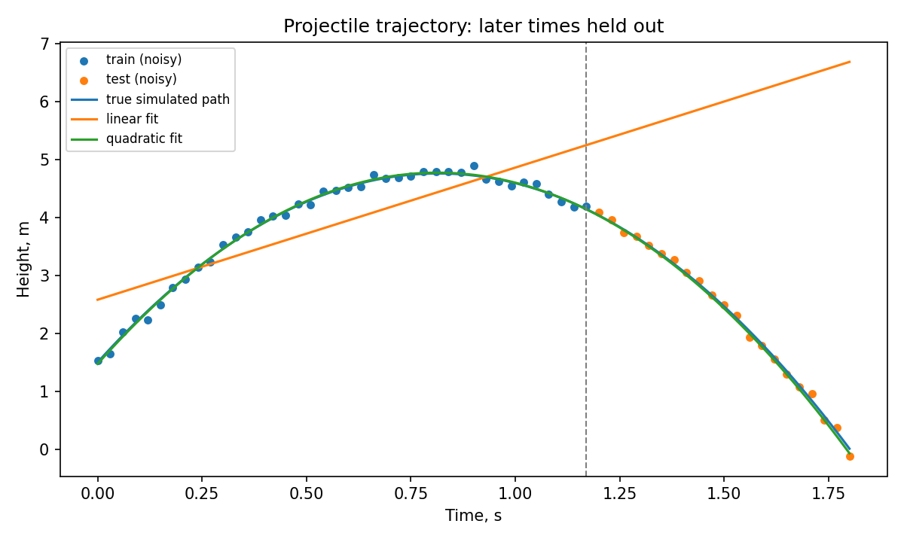

# Gravity from Data

По измерениям высоты после вертикального броска оцениваем ускорение свободного падения и сравниваем прогноз двух моделей на позднем участке траектории.

Данные синтетические: известная траектория с добавленным шумом. Это проверка метода, не реальное измерение g.

## Физика и признаки

В идеальной модели без сопротивления воздуха высота (в метрах) через время t (в секундах) равна:

```text
h(t) = h0 + v0*t - (g/2)*t².
```

Для генерации используются h0 = 1.5 м, v0 = 8 м/с и g = 9.81 м/с². К высоте добавляется независимый нормальный шум со стандартным отклонением 0.08 м. Число измерений — 61, от 0 до 1.8 с. Модель не учитывает сопротивление воздуха и не обрывает траекторию в момент удара о землю; выбранный интервал заканчивается до него.

Сравниваем два способа подать данные в `LinearRegression`:

| Модель | Признаки X | Предсказание |
|---|---|---|
| Прямая | `[t]` | `a + b*t` |
| Квадратичная | `[t, t²]` | `a + b*t + c*t²` |

Обе модели используют `LinearRegression`: зависимость линейна по коэффициентам, хотя `t²` делает траекторию параболой. По оценённому коэффициенту `c` получаем `g_est = -2*c`. Это имеет физический смысл в рамках модели без сопротивления воздуха. Знак оценки g код не ограничивает.

## Запуск

Нужен Python 3.12. 

```bash
python -m venv .venv
# Windows PowerShell: .venv\Scripts\python.exe -m pip install -r requirements.txt
# macOS / Linux: .venv/bin/python -m pip install -r requirements.txt
```


```bash
python train.py
python predict.py 1.2
python -m unittest discover -s tests -v
```

Датасет создаётся программой, GPU не нужен.

`train.py` сохраняет метрики, коэффициенты и график в `artifacts/`. Результат исходного запуска лежит в `reports/`. `predict.py` читает коэффициенты из `model.json`; поле `beyond_training_range` показывает, что запрошенное время выходит за обучающий интервал.



## Как устроена оценка

Первые 40 измерений (до 1.17 с) идут в train, последние 21 (с 1.20 с) — в test. Точки не перемешиваются: проверяется экстраполяция на более поздние моменты этой же траектории. Перенос на другие броски и реальные измерения не оценивается.

`MAE` — средняя абсолютная ошибка высоты в метрах: `mean(abs(h_pred - h_measured))`. Также считаем ошибку относительно истинной синтетической кривой; при реальном измерении она была бы неизвестна.

Результаты при `seed=42` — в [reports/metrics.json](reports/metrics.json). При смене шума и seed метрики могут измениться.

## Файлы

| Файл | Назначение |
|---|---|
| `physics.py` | Генерация измерений и признаков `[t]` / `[t, t²]` |
| `train.py` | Обучение, разбиение, MAE, график и сохранение коэффициентов |
| `predict.py` | Расчёт высоты в заданный момент по JSON |
| `tests/test_project.py` | Проверки форм, воспроизводимости и точного случая без шума |
| `reports/` | Результат исходного запуска |

Документация: [LinearRegression](https://scikit-learn.org/1.8/modules/generated/sklearn.linear_model.LinearRegression.html), [train_test_split](https://scikit-learn.org/1.8/modules/generated/sklearn.model_selection.train_test_split.html) (в коде разделение выполнено срезами, чтобы подчеркнуть порядок во времени).
